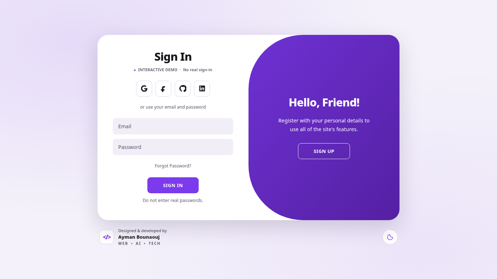
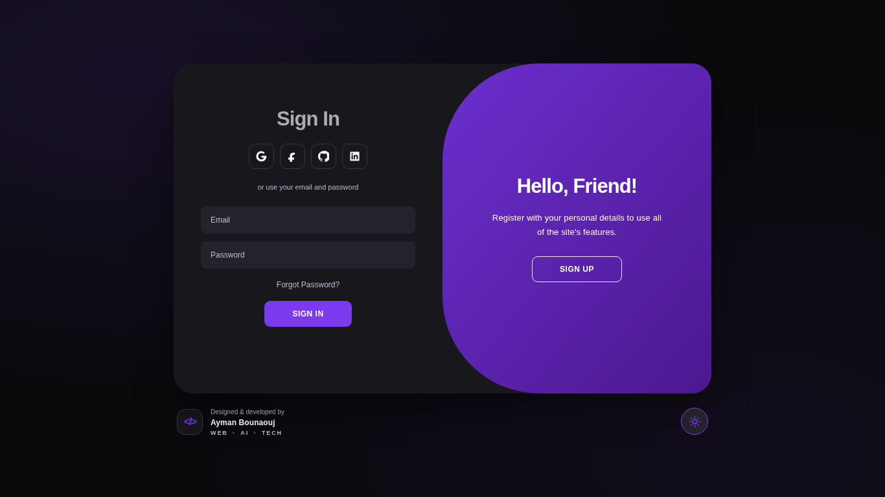
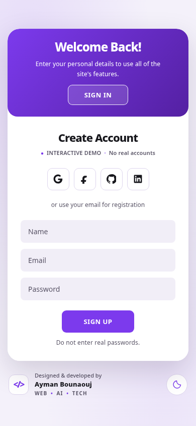

# VioletGate

**An interactive, animated sign-in / sign-up UI demo — designed and developed by Ayman Bounaouj.**

[**Live demo ↗**](https://aymanbouanouj.github.io/violetgate/) · [Source code](https://github.com/aymanbouanouj/violetgate)

> [!IMPORTANT]
> VioletGate is a **frontend-only demo**, not a real authentication service. No accounts are created, passwords are not verified or transmitted, and OAuth/password-reset actions are illustrative. **Do not enter real credentials.**

## Preview

| Light mode | Dark mode |
| --- | --- |
|  |  |

<details>
<summary>Mobile preview</summary>



</details>

## Features

- Animated transitions between sign-in and sign-up on desktop, plus a responsive stacked layout for mobile.
- Purple (`#7C3AED`), black, and white branding; light/dark modes with a saved preference.
- Keyboard-accessible interactions with focus management and reduced-motion support.
- Built-in SVG social icons, no external font/icon requests or framework runtime.
- Frontend-only validation and clear notices that authentication is not implemented.
- Social sharing metadata, browser favicon, and GitHub Pages hosting.

## Tech

HTML5, CSS3, and vanilla JavaScript. No package installation or build step is required to use the page.

## Project structure

```text
violetgate/
├── index.html
├── assets/
│   ├── css/style.css
│   ├── js/script.js
│   ├── icons/favicon.svg
│   └── previews/            # Screenshots displayed in this README
├── scripts/verify.mjs      # Static integrity, privacy, and security checks
├── .github/workflows/quality.yml
├── .gitignore
├── .gitattributes
├── .editorconfig
├── .nojekyll
└── README.md
```

## Run and verify

Open `index.html` in a browser, or use VS Code Live Server.

```bash
node --check assets/js/script.js
node scripts/verify.mjs
```

The GitHub Actions workflow automatically runs these checks after pushes and on pull requests. Live browser interaction has also been verified locally; the automated static checks are not a replacement for accessibility or security testing.

## Privacy and security scope

- This page stores **only the theme preference** in `localStorage` under `violetgate-theme`.
- Neither passwords nor email addresses are stored or sent by the demonstration logic. The demo action buttons are not HTML submit buttons and sensitive inputs have no `name` attributes.
- No Google Fonts, Font Awesome, remote APIs, analytics, or tracking scripts are required to render the demo.
- A real authentication implementation would require a separately secured backend, HTTPS, server-side validation, rate limiting, and secure session management.

## Attribution and reuse

Designed & developed by **Ayman Bounaouj**. This repository does **not** currently provide an open-source license; public visibility does not automatically grant reuse rights. The embedded example platform logos remain trademarks of their respective owners.
